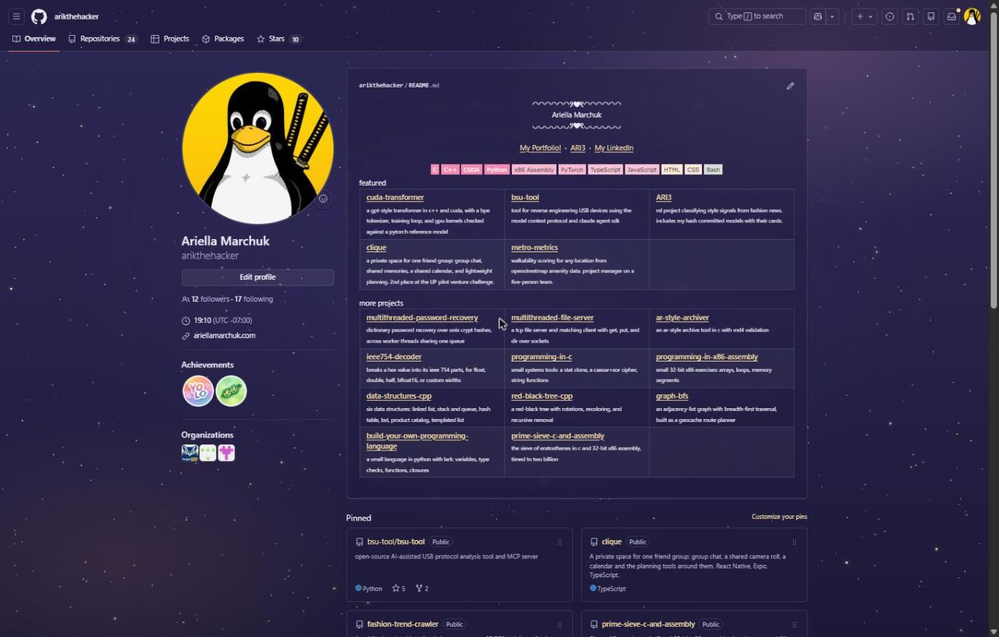

# github night sky

a chrome extension that puts a soft, sparkly nighttime sky behind github. indigo gradient, warm glows in the corners, and gold and lavender stars that twinkle.



## quickstart

```bash
git clone https://github.com/arikthehacker/github-night-sky.git
```

no git? grab the zip from [releases](https://github.com/arikthehacker/github-night-sky/releases/latest) and unzip it.

1. open `chrome://extensions`
2. turn on **developer mode** (top right)
3. click **load unpacked** and pick the `github-night-sky` folder
4. open any github page

expected result:

```
github.com loads in dark mode over the night sky
cards are see-through, the header is frosted, stars twinkle in the background
```

to turn it off, flip its toggle on `chrome://extensions`.

## how it works

it's three small files and no permissions. chrome injects them into `github.com` and `gist.github.com`.

| file | job |
| --- | --- |
| `stars.css` | the sky gradient and four tiled layers of stars |
| `theme.css` | recolors github's theme tokens so the sky shows through |
| `theme.js` | keeps github in dark mode so code and diffs stay readable |

**the stars are plain css.** each layer is a fixed pseudo-element with an svg tile as its background. the twinkle only animates `opacity`, so the gpu handles it and the page does no work per frame. the tiles are different sizes (557, 683, 743, 811px), so the repeat never lines up.

```css
html::after {
  background: url("data:image/svg+xml,...") 0 0 / 683px;
  animation: gh-night-twinkle 5.3s ease-in-out 0s infinite alternate;
  will-change: opacity;
}
@keyframes gh-night-twinkle { from { opacity: .25; } to { opacity: 1; } }
```

with reduced motion turned on in your os, the twinkle stops and the stars stay still.

**the theme swaps tokens instead of restyling elements.** github's colors come from css variables, and custom properties inherit, so overriding them on the theme root reaches the whole page.

```css
:root,
[data-color-mode] {
  --bgColor-default: transparent !important;
  --fgColor-accent: #f3d9a4 !important;
  --contribution-default-bgColor-4: #f3d9a4 !important;
}
```

**dark mode is forced** so syntax colors, diffs and alerts use github's own dark palette. github only downloads the theme files you picked in settings, so the script loads the dark one if it's missing.

```js
const sheet = document.querySelector('link[data-color-theme="dark"]:not([href])');
if (sheet)
{
  sheet.href = sheet.dataset.href;
}
```

## changing the stars

`stars.css` is generated. edit the counts, colors or tile sizes in `make_stars.py`, then rebuild:

```bash
python3 make_stars.py
```

expected output:

```
wrote .../github-night-sky/stars.css (7205 bytes)
```

reload the extension on `chrome://extensions` to see the change.
